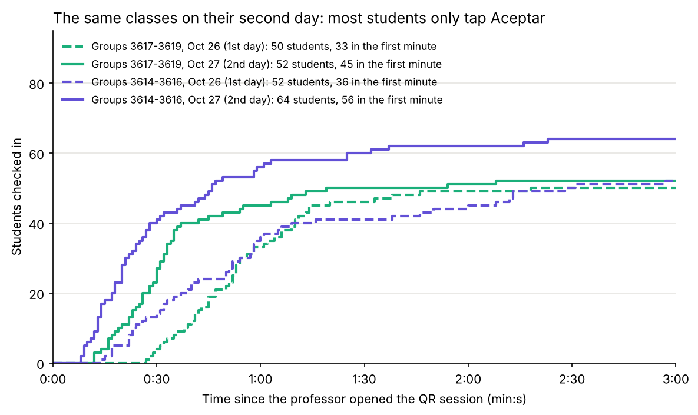

# UniPresence

Privacy-preserving physical presence verification for large classrooms.

Reviewing this project? [`docs/reviewer-guide.md`](docs/reviewer-guide.md) is a short path through it.

## The problem

Some Medicine courses at a university in Colombia have hundreds of students, while the university requires professors to record attendance. Calling students one by one takes a significant amount of class time, so in practice attendance is often not recorded. The professor in every pilot, who is my mother, did not take attendance in her large classes before this app: calling 88 names took 8 min 50 s when she tried it for this project.

The challenge is not simply digitizing an attendance list. It is verifying that a student is physically present in the classroom without collecting sensitive data such as their location.

## How it works (version 2)

The teacher creates an account, creates a class (with or without a student list) and presses "Tomar asistencia". The projector shows a QR code that changes every 10 seconds.

The student points the phone camera at the QR, sees the name of the class and taps "Aceptar". The first time, the student enters their university code or institutional username and accepts the data policy, which binds that phone to their identity. After that, scanning and tapping "Aceptar" is enough. A green confirmation on screen is the receipt.

The server checks that the nonce in the QR exists and has not expired before recording attendance. If a code moves to a different phone or browser, the change is allowed but recorded, shown to the teacher during class and marked in the export. The browser used for each check-in is logged for fraud analysis.

## How the design changed after the first pilot

Version 1 asked each student to register once with a private code printed on a paper slip, through a separate registration link, before scanning the attendance QR.

On September 22, 2026 it ran in a real genetics lab: 22 students, the professor operating it alone. 15 checked in; 7 could not.

The professor's video showed why. Students opened the registration link inside WhatsApp, then scanned the attendance QR with the camera, which opens Safari. The phone binding lived in a browser cookie, and each browser keeps its own cookies, so the system no longer recognized them. It told students who had registered minutes earlier that their code was "already used". I had built device binding on something narrower than a device.

The problem was not cheating or the network. Every extra step I asked of students (a slip to keep, a code to type, a separate registration link, a second app) was a point where a real student could drop out. Version 2 is built around fewer steps: one QR, the student sees the class and taps "Aceptar". Device changes are no longer refused; they are recorded and made visible to the teacher.

The pilot also lost its stored data when the free Render instance went to sleep. That is why version 2 stores everything in Postgres.

## What is built

- A rotating attendance QR code
- One-scan check-in: scan, see the class, tap "Aceptar"
- Phone binding to the student's university code, with every device change logged and visible to the teacher
- Browser logging per check-in, for fraud analysis
- Individual teacher accounts, optionally restricted by a signup code
- Classes with or without a student list; the list is uploaded once through the teacher interface
- Manual attendance override for professors
- Attendance export to CSV and PDF
- Ending an attendance session and a page of previous classes
- Persistent storage in Postgres
- Automated tests

Added in version 2.1, after testing with the professor's real lists:

- Sign-in with the student code, the institutional username or the email (only the username is saved)
- Data policy consent the first time a phone is linked (Colombia's Law 1581 of 2012)
- Class lists exported from Brightspace or Banner, with groups
- Students who are not on the list wait as pending, and the professor validates them against the list later
- Correcting a student's code or name, and deleting test sessions with their data
- Reports that can be sorted and filtered, with an anonymous export of check-in times

Added after the first large classes (October 26, 2026):

- The projected screen shows only the QR and the count, no names
- Lists that only have codes ask students for the code
- Alerts that name the student, can be folded, and leave once they are solved
- Marking a late student present with a note, even after class

## Results so far

Six real classes in October 2026 with version 2.1, from 15 to 64 students. No student was locked out by an error of the app. In a class of 88 on the list, the roll call by hand took 8 min 50 s; the QR took about 2 min 40 s from opening it to closing it. On the second day, a student whose phone was already linked tapped Aceptar about 3 seconds after scanning. The numbers, how each was measured, and what they do not show are in [`docs/results.md`](docs/results.md).



## What is not built yet

- Protection against live relay attacks, such as someone sharing the current QR through a video call
- The university's institutional authentication for professors
- A summary of each student's absences for the course, for the rule that more than 25 % of absences means no final exam

Nothing in the app proves that a phone is physically in the room, so it should not be treated as proof of presence under every attack scenario. I considered Bluetooth (BLE) and rejected it: on the iPhone it needs an app or a beacon, and the app has to work with nothing to install or buy.

## Security

UniPresence is designed to reduce simple forms of attendance fraud without collecting student location data. Rotating nonces limit the usefulness of old QR codes, and teacher-only endpoints require an individual teacher account.

Version 2 makes a deliberate trade. University codes are not secret, so a student who knows a classmate's code can move that classmate's registration to another phone. The system does not block this, because blocking is exactly what locked 7 present students out in the first pilot. Instead, every device change is recorded, counted on the teacher's screen while class runs and marked in the export. The one-phone-one-student rule is enforced by visibility rather than by refusal.

I attacked the app on purpose with real phones on October 25, 2026 ([`docs/attack-protocol.md`](docs/attack-protocol.md)). An old QR, a friend's code from your own phone and the QR without a login were all stopped; a friend's code on another phone got in with an alert. A live relay over a video call worked 5 out of 5 times, and the data shows that a shorter QR would not stop it. The full analysis, including vulnerabilities found during development and alternatives considered, is in [`docs/threat-model.md`](docs/threat-model.md).

## Running it locally

```bash
git clone https://github.com/andr3sdmm/unipresence.git
cd unipresence
python3 -m venv venv
source venv/bin/activate
pip install -r requirements.txt
```

Version 2 stores everything in Postgres. Create a free database (for example on Neon), copy its connection string, and start the server with it:

```bash
DATABASE_URL="postgresql://..." uvicorn main:app --reload
```

Open the site, create a teacher account, create a class (with or without a list; `roster.example.csv` is a sample list), and press "Tomar asistencia".

Optional: `TEACHER_SIGNUP_CODE="..."` makes new teacher accounts require that code.

To run the tests, point them at an empty database they are allowed to wipe (never the production one):

```bash
pip install -r requirements-dev.txt
TEST_DATABASE_URL="postgresql://..." pytest -q
```

## Project log

Development decisions, tests, failures, and changes are documented in [`docs/experiments.md`](docs/experiments.md). What data is stored and why is in [`docs/data-handling.md`](docs/data-handling.md).

## A note on how this was built

AI tools were used to write the application code under my direction. I defined the problem, made the design decisions, tested the system, and analyzed its security behavior.

During testing, I independently found a problem with the manual attendance flow. Three additional security weaknesses were identified during an AI-assisted review of the design, including misuse of student codes and initially unprotected teacher and QR endpoints. I then incorporated the findings into the design and tested the resulting changes.

The most important problem was not found in testing but in the classroom pilot on September 22, from the professor's video. I diagnosed it and redesigned the check-in flow around it, which became version 2.

I wrote the project log and threat model to document the development process, including what worked, what failed, what was changed, and which risks remain open.
