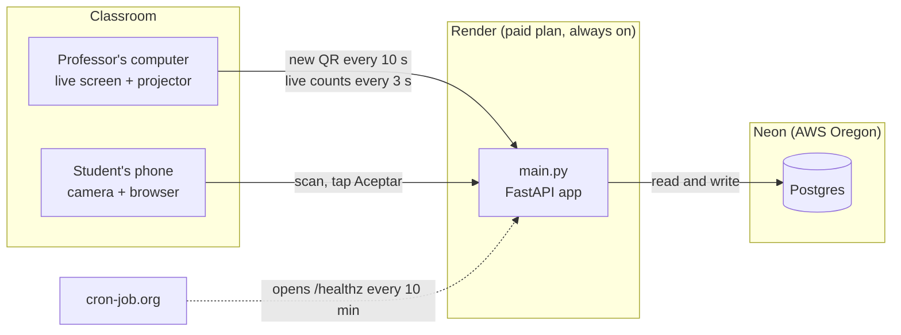
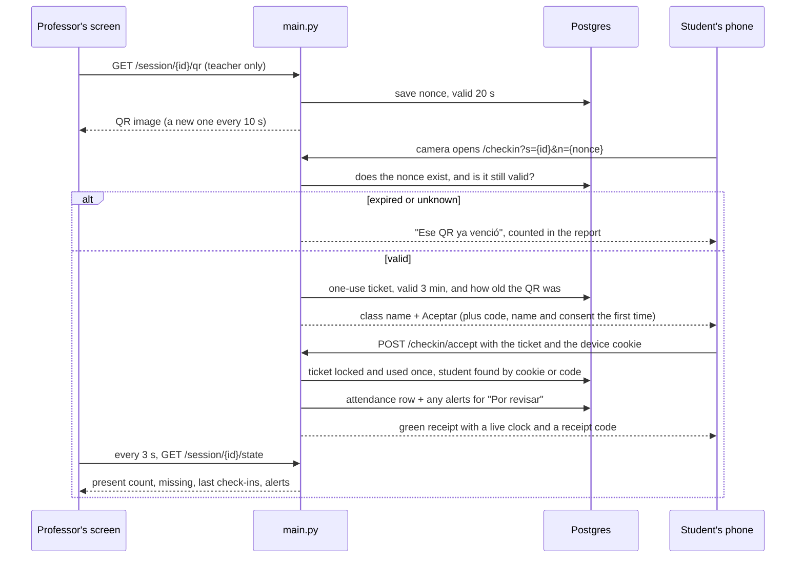
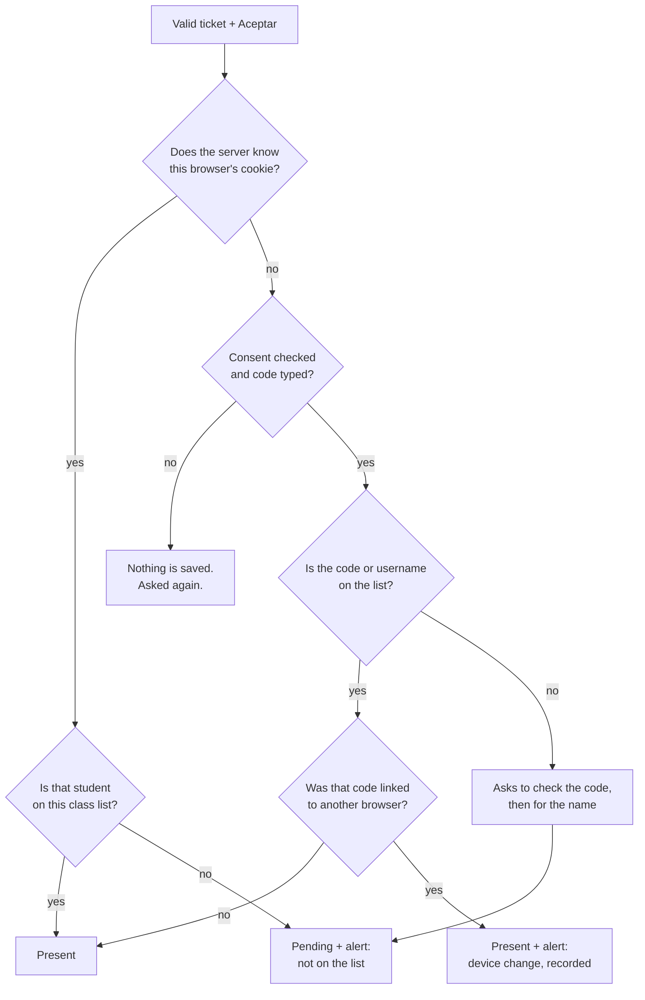
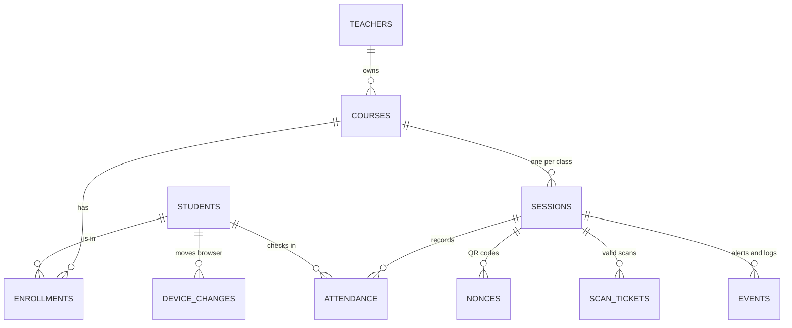

# Architecture — UniPresence version 2.1

How the pieces fit together, and what happens between the moment a student points the camera at the projector and the moment the professor sees them as present. Everything here is in `main.py`; the numbers (10 s, 20 s, 3 min) are constants at the top of that file.

## The pieces

- **No app to install.** The student only uses the phone camera and the browser it opens.
- **The server holds the truth.** The QR only carries a short random code (a nonce). Whether it is valid, who the student is and whether they are on the list is decided on the server, never on the phone.
- **Postgres outside the server.** Version 1 kept its data in a file inside Render and lost it on September 22. Now Render can restart without touching anything.

## One check-in, step by step

Why two steps (nonce, then ticket): the nonce has to die fast, so a photo of the QR is useless a few seconds later. But a student typing their code for the first time needs more than 20 seconds. So the scan is checked right away and turned into a ticket that gives them 3 minutes to tap Aceptar. That split came from Day 1, when the QR expired while I was typing.

## What decides "present", "pending" or "review"

This is for a class with a list. In a class without one (a conference, or a class whose list has not arrived), everyone who checks in waits as pending until the professor approves them or uploads the list and validates them.

Every alert goes to "Por revisar" on the professor's screen and in the report: a code that moves to another browser, three or more new phones from the same browser and system within a minute, a code that is not on the list, a link opened inside WhatsApp or Instagram. They are leads, not proof. The professor confirms or rejects each one, and the decision is written next to the alert, which is never deleted.

Two rules never bend:

1. **A known browser only marks for its owner.** Whatever code is typed is ignored, so a student cannot mark a friend from their own phone.
2. **A present student is never refused.** That is what locked 7 students out on September 22. A device change is allowed and made visible instead.

## Data model

- A **student** is one row shared by all their classes, even with different professors, so a student in six classes links their phone once. When a new professor uploads a list, the app finds the students it already knows by their code or username, and their phones just tap Aceptar. If the new list uses a different number for someone (like Brightspace's internal id), that student checks in as pending and the professor validates them by name. Each professor still only sees the students in their own classes.
- An **enrollment** says whether they are approved for that class or pending, and which group (NRC) they are in.
- **Attendance** is unique per session and student, so scanning twice gives back the same receipt instead of a second row.
- Deleting a class or a session deletes everything under it.

What each field is, and why it is stored, is in [`data-handling.md`](data-handling.md). What can still go wrong is in [`threat-model.md`](threat-model.md).

## What is not in this design

- **Location or Bluetooth.** Nothing proves the phone is in the room; a live relay of the current QR still works (tested on October 25). GPS is not precise indoors and Bluetooth would need an app or a beacon, so both were rejected (`threat-model.md`, section 4).
- **The university's login.** Professors have their own accounts.
- **An app on the phone.** On purpose: every extra step lost students in the first pilot.
