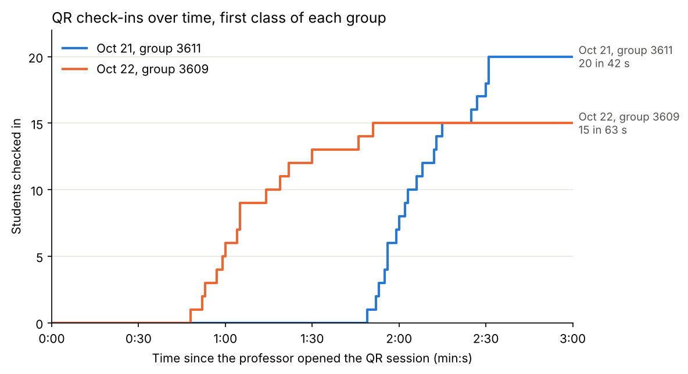

# Results

Numbers measured in real classes. Each one says how it was measured, because a stopwatch, a video and the server's clock do not measure the same thing. Student names, codes and videos never go into this repository; the check-in times in `analysis/data/` only keep seconds.

---

## Session 0 — September 22, 2026: first pilot (version 1)

Genetics lab, 22 students, the professor operating it alone, with printed slips and a separate registration QR.

- 15 students checked in. 7 could not.
- The cause was the registration flow: WhatsApp and Safari keep different cookies, so the system no longer recognized students who had registered minutes earlier. Details in `experiments.md`, Day 4.
- The stored data was lost when the free Render instance went to sleep.

No times were measured in this session.

## Session 0a — October 19, 2026: baseline, roll call by hand

Small group, 27 students. The professor called the roll by reading her Excel sheet, without the app.

- 1 min 47 s from the first name to the last, with the file already open: about 4 seconds per name.
- About 30 s more to open the file and get ready.

## Session 1 — October 21, 2026: Fundamentos, group 3611 (version 2.1)

26 students on the list, 20 present. Attendance was taken without the list, which was loaded after class. First time with the app for everyone.

| Measure | How | Time |
|---|---|---|
| Roll call by hand, 26 names | video, names only | 2 min 12 s |
| QR, as timed by the professor | stopwatch | 1 min 24 s |
| QR, first to last check-in | server clock | 42 s |
| QR, session open to close | server clock | about 3 min |

- 20 of 20 present students checked in with the QR. 0 marked by hand.
- The first check-in came 1 min 49 s after the session opened.
- 1 alert for several new phones in a row (normal on the first day), and 1 scan of an expired QR.
- All 20 pending students were later matched to the list: 5 exact, 13 by name, 2 by a similar name confirmed by the professor.

## Session 2 — October 22, 2026: Fundamentos, group 3609 (version 2.1)

22 students on the list, 15 present, with the Brightspace list already loaded. First time with the app for this group.

| Measure | How | Time |
|---|---|---|
| Roll call by hand, 22 names | video, from opening the computer | 2 min 16 s (about 20 s opening the list) |
| QR, first to last check-in | server clock | 63 s |
| QR, first 13 check-ins | server clock | 42 s |

- 15 of 15 present students checked in with the QR. 0 marked by hand.
- The first check-in came 48 s after the session opened, a minute earlier than on October 21.
- 2 students typed their 9-digit code, which the Brightspace list does not have, so they waited as pending and also showed as absent under their 6-digit id. They were the last two check-ins.

The chart is made by `analysis/checkin_timeline.py` from `analysis/data/dia08_tiempos_qr.csv` and `analysis/data/dia09_tiempos_qr.csv`.

---

## Summary

| | Sep 22 | Oct 19 | Oct 21 | Oct 22 |
|---|---|---|---|---|
| Version | 1 | none (by hand) | 2.1 | 2.1 |
| Students present | 22 | 27 | 20 | 15 |
| Checked in with the system | 15 | — | 20 | 15 |
| Could not check in | 7 | — | 0 | 0 |
| Marked by hand | — | — | 0 | 0 |
| Roll call by hand, whole list | — | 1 min 47 s (+ about 30 s opening the file) | 2 min 12 s (video, names only) | 2 min 16 s (video, includes opening the list) |
| Roll call by hand, per name | — | about 4 s | about 5 s | about 5 s |
| QR, timed by the professor | — | — | 1 min 24 s | not timed |
| QR, session opened to last check-in (server) | — | — | 2 min 31 s | 1 min 51 s |
| QR, first to last check-in (server) | — | — | 42 s | 63 s |

The closest to a fair comparison is October 22: both times include getting started, and the QR took 1 min 51 s against 2 min 16 s by hand. On October 21 the QR was slower from start to finish (2 min 31 s against 2 min 12 s): the app was asleep when class started, and it was the first time for the professor and the students. The roll call video that day only counted names.

## What this does and does not show

It shows that the problem from September 22 is gone: in two classes, every present student checked in, and nobody had to be marked by hand. Once students start scanning, the whole class is in within about a minute.

It does not show yet that the QR saves time for the professor. The roll call videos count names, while the server counts from the first scan to the last; neither one counts the minute or so before the first scan (opening the page, projecting the QR, explaining). The two classes were also everyone's first time, when each student types their code and accepts the data policy. And there are only two classes, small ones, with a professor who knew she was testing something.

## What to measure next

Only things that came out of these classes:

1. Time both methods the same way: from the moment the professor starts to the last student, including opening the list or the page.
2. The time before the first scan. Since October 22 the app runs on Render's paid plan and never sleeps, so the page should open right away instead of waiting about a minute.
3. A second class with the same students, when checking in should be a single tap.
4. A large class (about 100 students), where calling names grows with the class and the QR should not.
