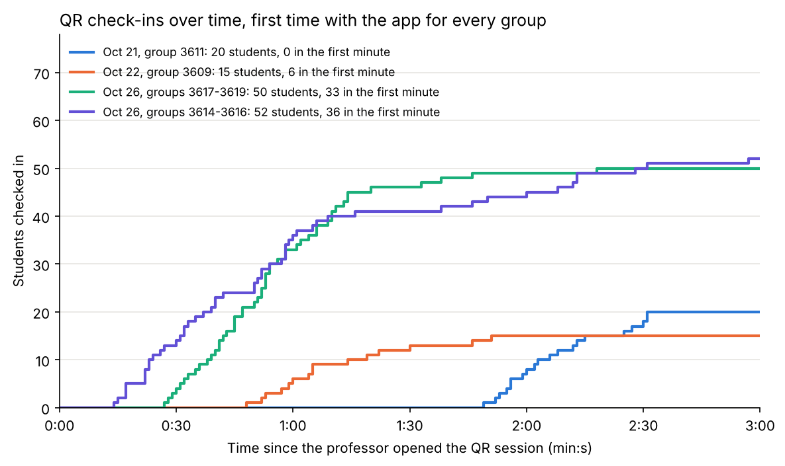
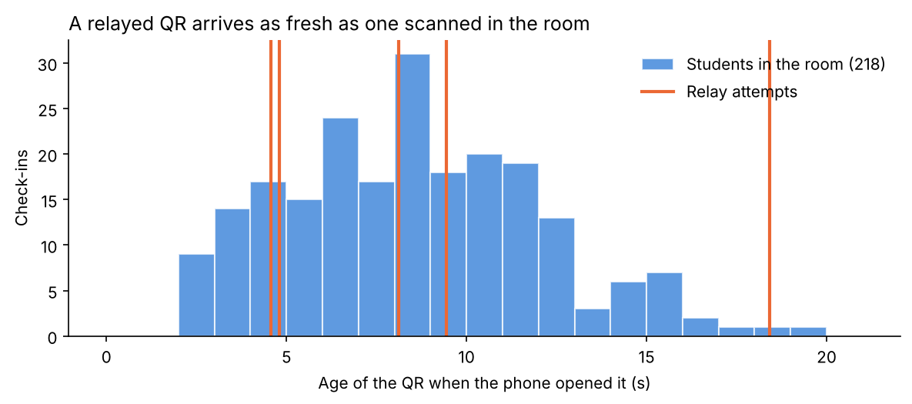

# Results

Numbers measured in real classes. Each one says how it was measured, because a stopwatch, a video and the server's clock do not measure the same thing. Student names, codes and videos never go into this repository; the check-in times in `analysis/data/` only keep seconds.

---

## Session 0 — September 22, 2026: first pilot (version 1)

Genetics lab, 22 students, the professor operating it alone, with printed slips and a separate registration QR.

- 15 students checked in. 7 could not.
- The cause was the registration flow: WhatsApp and Safari keep different cookies, so the system no longer recognized students who had registered minutes earlier. Details in `experiments.md`, Day 4.
- The stored data was lost when the free Render instance went to sleep.

No times were measured in this session.

## Session 0a — October 19, 2026: baseline, roll call by hand

Small group, 27 students. The professor called the roll by reading her Excel sheet, without the app.

- 1 min 47 s from the first name to the last, with the file already open: about 4 seconds per name.
- About 30 s more to open the file and get ready.

## Session 1 — October 21, 2026: Fundamentos, group 3611 (version 2.1)

26 students on the list, 20 present. Attendance was taken without the list, which was loaded after class. First time with the app for everyone.

| Measure | How | Time |
|---|---|---|
| Roll call by hand, 26 names | video, names only | 2 min 12 s |
| QR, as timed by the professor | stopwatch | 1 min 24 s |
| QR, first to last check-in | server clock | 42 s |
| QR, session open to close | server clock | about 3 min |

- 20 of 20 present students checked in with the QR. 0 marked by hand.
- The first check-in came 1 min 49 s after the session opened.
- 1 alert for several new phones in a row (normal on the first day), and 1 scan of an expired QR.
- All 20 pending students were later matched to the list: 5 exact, 13 by name, 2 by a similar name confirmed by the professor.

## Session 2 — October 22, 2026: Fundamentos, group 3609 (version 2.1)

22 students on the list, 15 present, with the Brightspace list already loaded. First time with the app for this group.

| Measure | How | Time |
|---|---|---|
| Roll call by hand, 22 names | video, from opening the computer | 2 min 16 s (about 20 s opening the list) |
| QR, first to last check-in | server clock | 63 s |
| QR, first 13 check-ins | server clock | 42 s |

- 15 of 15 present students checked in with the QR. 0 marked by hand.
- The first check-in came 48 s after the session opened, a minute earlier than on October 21.
- 2 students typed their 9-digit code, which the Brightspace list does not have, so they waited as pending and also showed as absent under their 6-digit id. They were the last two check-ins.

The chart is made by `analysis/checkin_timeline.py` from the anonymous times in `analysis/data/`. It includes the two large classes of October 26.

## Session 3 — October 26, 2026: two large classes, first day (version 2.1)

Same course, two classes in an auditorium, with the Banner list loaded. First time with the app for everyone.

| Measure | How | Groups 3617–3619 | Groups 3614–3616 |
|---|---|---|---|
| Students on the list | list | 88 | 80 |
| Checked in with the QR | server | 50 | 52 |
| Roll call by hand, whole list | video | 8 min 50 s | not done |
| QR, session opened to first check-in | server clock | 27 s | 14 s |
| QR, checked in during the first minute | server clock | 33 | 36 |
| QR, session opened to last check-in | server clock | 2 min 18 s | 2 min 57 s |
| Time to tap Aceptar after scanning, median | server clock | 29 s | 21 s |

- The professor does not normally call the roll in these classes; she did it only for this test (`experiments.md`, Day 13).
- The roll call by hand includes about 40 s to find the list and start, every name with its "presente", and going back over the list for students who came in late.
- 14 and 17 students typed their username on a list that only has codes, and waited as pending until the professor validated them. Fixed the same day (`experiments.md`, Day 11).

## Session 4 — October 27, 2026: the same two classes, second day

| Measure | How | Groups 3617–3619 | Groups 3614–3616 |
|---|---|---|---|
| Students counted in the room by the professor | by eye | about 54 | not counted |
| Checked in with the QR | server | 52 | 64 |
| QR, from opening the link to closing it | professor | about 2 min 40 s | not timed |
| QR, session opened to first check-in | server clock | 12 s | 8 s |
| QR, checked in during the first minute | server clock | 45 | 56 |
| QR, session opened to last check-in | server clock | 2 min 8 s | 2 min 23 s |
| Phones already linked: time to tap Aceptar, median | server clock | 3.3 s (30 students) | 2.8 s (33 students) |
| Phones linked that day: time to tap Aceptar, median | server clock | 11 s (22 students) | 16 s (31 students) |

Dashed lines are the first day, solid lines the second. The chart is made by `analysis/checkin_timeline.py` from the anonymous times in `analysis/data/`.

## Relay: can a shorter QR stop it?

On October 25 a live relay over a video call worked 5 out of 5 times (`attack-protocol.md`). The server keeps how old the QR was when each phone opened it, so I compared the relays with every real check-in from Sessions 3 and 4.

| QR lifetime | Students in the room let in (218) | Relays let in (5) |
|---|---|---|
| 8 s | 44 % | 2 of 5 |
| 10 s | 67 % | 4 of 5 |
| 12 s | 84 % | 4 of 5 |
| 15 s | 95 % | 4 of 5 |
| 20 s (current) | 100 % | 5 of 5 |

The relayed QR arrives as fresh as one scanned in the room, so any lifetime short enough to stop relays would lock out present students, which is the failure of the first pilot. Made by `analysis/relay_analysis.py`. Five relays in a test are a small sample: they show that a relay is possible and fast, not how often real students would try it.

---

## Summary

Small classes, first day with the app:

| | Sep 22 | Oct 19 | Oct 21 | Oct 22 |
|---|---|---|---|---|
| Version | 1 | none (by hand) | 2.1 | 2.1 |
| Students present | 22 | 27 | 20 | 15 |
| Checked in with the system | 15 | — | 20 | 15 |
| Could not check in | 7 | — | 0 | 0 |
| Marked by hand | — | — | 0 | 0 |
| Roll call by hand, whole list | — | 1 min 47 s (+ about 30 s opening the file) | 2 min 12 s (video, names only) | 2 min 16 s (video, includes opening the list) |
| Roll call by hand, per name | — | about 4 s | about 5 s | about 5 s |
| QR, timed by the professor | — | — | 1 min 24 s | not timed |
| QR, session opened to last check-in (server) | — | — | 2 min 31 s | 1 min 51 s |
| QR, first to last check-in (server) | — | — | 42 s | 63 s |

Large classes, groups 3617–3619:

| | Oct 26 (first day) | Oct 27 (second day) |
|---|---|---|
| Roll call by hand, whole list of 88 | 8 min 50 s (video) | not done |
| Checked in with the QR | 50 | 52 (about 54 counted in the room) |
| QR, timed by the professor | — | about 2 min 40 s, including about 40 s to open it and explain |
| QR, session opened to last check-in (server) | 2 min 18 s | 2 min 8 s |
| Checked in during the first minute | 33 | 45 |
| Time to tap Aceptar, median | 29 s | 3.3 s with a linked phone |

In the small classes the two methods took about the same time: a roll call of 20 names is short. In the class of 88 the roll call took 8 min 50 s and the QR about 2 min 40 s, from opening the link to closing it. The two were measured on different days, and the roll call also went back for students who came late, so the comparison is approximate. The roll call grows with every name; the QR barely grew from 15 students to 64.

The professor also said that before the app she did not take attendance in these classes at all, because calling the roll takes too much class time. So in practice the QR is not replacing a roll call; it is replacing no attendance.

## What this does and does not show

It shows that the problem from September 22 is gone: in six classes with version 2.1, no student was locked out by an error of the app. A few students who arrived as the professor was closing the QR could not check in, and she did not find the button to mark them by hand (`experiments.md`, Day 13). In a large class, most students are in within the first minute, and on the second day a student with a linked phone only needs about 3 seconds after scanning.

It shows that the QR saves time in a large class: about 2 min 40 s against 8 min 50 s in the same groups.

It does not show that everyone who checked in was in the room. A live relay works, and a shorter QR does not stop it (see the relay section). The only independent check is the professor's head count: she says it usually matched the count on the screen, and on October 27 it was about 54 against 52 check-ins. I have not crossed a roll call with the QR name by name. All classes were with one professor, my mother, who knew she was testing something. She also told me that students do send the QR to classmates who are not in class, as a photo on WhatsApp.

## What to measure next

Only things that came out of these classes:

1. A roll call and the QR on the same day, crossed name by name, to see who was in the room and did not scan.
2. Attendance at a moment the professor does not announce, to see whether students who are present still all get in.
3. A second professor, who did not help design the app. The professor offered to ask a colleague.
4. A photo of the QR forwarded right away on WhatsApp: how old it is when it arrives, compared with the 218 check-ins in the room.
5. A QR that changes every 2 or 3 seconds instead of 10, to see whether a shorter life is possible without locking anyone out.
6. Whether the professor can mark a late student and understand the alerts without help, once those are on her screen.
